<a href="https://github.com/TaiNingTy">English</a> &nbsp;·&nbsp; <b>中文</b>

<a href="assets/editorial-zh-light.svg#gh-light-mode-only"><picture>
  <source media="(max-width: 600px)" srcset="assets/editorial-zh-light-compact.svg">
  
</picture></a>
<a href="assets/editorial-zh-dark.svg#gh-dark-mode-only"><picture>
  <source media="(max-width: 600px)" srcset="assets/editorial-zh-dark-compact.svg">
  
</picture></a>

 

<a href="assets/city-zh-light.svg#gh-light-mode-only"><picture>
  <source media="(max-width: 600px)" srcset="assets/city-zh-light-compact.svg">
  
</picture></a>
<a href="assets/city-zh-dark.svg#gh-dark-mode-only"><picture>
  <source media="(max-width: 600px)" srcset="assets/city-zh-dark-compact.svg">
  
</picture></a>

 

<a href="https://github.com/TaiNingTy/AI-Station-Configuration-Decision-Support-System#gh-light-mode-only"><picture>
  <source media="(max-width: 600px)" srcset="assets/card1-zh-light-compact.svg">
  
</picture></a>
<a href="https://github.com/TaiNingTy/AI-Station-Configuration-Decision-Support-System#gh-dark-mode-only"><picture>
  <source media="(max-width: 600px)" srcset="assets/card1-zh-dark-compact.svg">
  
</picture></a>

<a href="https://github.com/TaiNingTy/station-decision-support-v2#gh-light-mode-only"><picture>
  <source media="(max-width: 600px)" srcset="assets/card2-zh-light-compact.svg">
  
</picture></a>
<a href="https://github.com/TaiNingTy/station-decision-support-v2#gh-dark-mode-only"><picture>
  <source media="(max-width: 600px)" srcset="assets/card2-zh-dark-compact.svg">
  
</picture></a>

 

<a href="assets/specs-zh-light.svg#gh-light-mode-only"><picture>
  <source media="(max-width: 600px)" srcset="assets/specs-zh-light-compact.svg">
  
</picture></a>
<a href="assets/specs-zh-dark.svg#gh-dark-mode-only"><picture>
  <source media="(max-width: 600px)" srcset="assets/specs-zh-dark-compact.svg">
  
</picture></a>

 

由 Tai Ning 设计与制作 &nbsp;·&nbsp; Python + SVG，无框架

